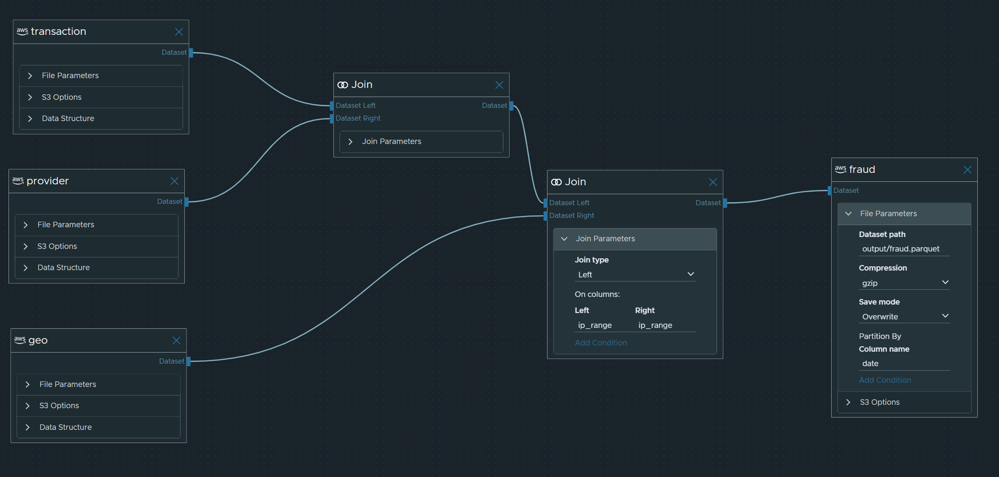
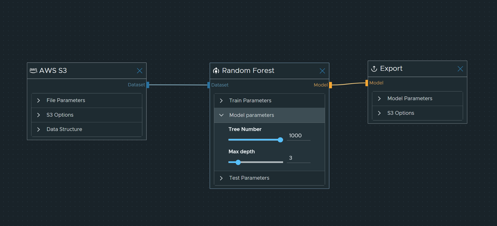

# Credit card fraud detection

An end-to-end example on the [graal Data Platform](https://graal.systems/en/docs): integrate
transaction data with low-code pipelines, explore it in a notebook, train a fraud model and
serve it. It illustrates the [fraud and claims](https://graal.systems/en/use-cases/fraud-and-claims)
use case.

The steps:

1. **Integrate** three CSV sources into one Parquet dataset with a low-code pipeline.
2. **Explore** the data in a Jupyter workspace.
3. **Model** fraud with a low-code pipeline (random forest), exported as pandas code.
4. **Refine** the model in a notebook and export it in a format MLServer can serve.

## Repository layout

| Folder | Content |
|---|---|
| `0-data` | Sample datasets (CSV) and a sample inference request (`input-fraud.json`) |
| `1-data-integration` | Low-code pipeline that joins the datasets |
| `2-data-integration-generated-code` | The same pipeline exported as pandas code |
| `3-fraud-detection-model` | Low-code pipeline that trains the model |
| `4-fraud-detection-model-generated-code` | The same pipeline exported as pandas code |
| `5-exploration-model-creation-notebooks` | Exploration and model creation notebooks |
| `images` | Screenshots used in this README |

## Data

Three datasets: `transaction.csv` (one row per transaction), `geo.csv` (country of each IP
range) and `provider.csv` (provider of each IP range).

### Transactions

| Column | Description | Type | Example |
|---|---|---|---|
| `CN` | Card number | Integer | 6011636165535360 |
| `date` | Date of the transaction | Date | 2022-02-01 |
| `transaction_amount` | Amount, in cents | Integer | 13595 |
| `ip` | IP address | String | 6.200.204.63 |
| `ip_range` | Range of the IP address | String | 6.0.0.0/8 |
| `is_valid` | Whether the transaction is legitimate | Boolean | True |

### Geography

| Column | Description | Type | Example |
|---|---|---|---|
| `ip_range` | Range of IP addresses | String | 163.10.0.0/16 |
| `country_name` | Country name | String | Argentina |
| `continent_name` | Continent name | String | South America |
| `continent_code` | Continent code | String | SA |
| `is_in_european_union` | Whether the country is in the EU | Integer (0 or 1) | 0 |

### Providers

| Column | Description | Type | Example |
|---|---|---|---|
| `ip_range` | Range of IP addresses | String | 101.144.0.0/12 |
| `provider` | IP provider | String | CyberGhost |

## 1. Integrate the datasets

Upload the three CSV files to the `input/` folder of your project's bucket, then import
`1-data-integration/dag-data-integration.json` in the low-code editor. The pipeline reads the
files, renames `transaction_amount` to `amount`, joins the three datasets on `ip_range` and
writes `output/fraud.parquet`.



Replace the `<ACCESS_KEY>` and `<SECRET_KEY>` placeholders with references to your storage
credentials. Never commit real keys.

Low-code pipelines export to pandas or PySpark code. The pandas export is in
`2-data-integration-generated-code`; it reads the bucket from `GRAAL_BUCKET` and the
credentials from the `AWS_ACCESS_KEY_ID`, `AWS_SECRET_ACCESS_KEY`, `AWS_ENDPOINT_URL` and
`AWS_REGION` environment variables.

## 2. Explore the data

Open `5-exploration-model-creation-notebooks/Fraud detection - Data Exploration.ipynb` in a
Jupyter workspace. It describes the columns, their statistics and distributions, and the
correlations between variables, to choose a model.

## 3. Train a model with a low-code pipeline

`3-fraud-detection-model/dag-fraud-detection.json` trains a random forest on the integrated
dataset and saves it to the bucket with joblib.



Its pandas export is in `4-fraud-detection-model-generated-code`:

```python
# Implementing a RandomForestClassifier model
x_columns = df[["amount", "is_in_european_union"]]
y_column = df["is_valid"]
X_train, X_test, y_train, y_test = train_test_split(x_columns, y_column, test_size=0.2, random_state=42)

model = RandomForestClassifier(n_estimators=1000, max_depth=3, random_state=42)
model.fit(X_train, y_train)
print(f"accuracy_score: {accuracy_score(y_test, model.predict(X_test))}")

joblib.dump(model, s3.open(f"s3a://{BUCKET}/output/models/fraud/model.joblib", "wb"))
```

## 4. Refine and serve the model

`5-exploration-model-creation-notebooks/Fraud detection - Model creation.ipynb` adds the
provider, country and continent features (one-hot encoded, with scaled amounts), rebalances
the classes with ADASYN, trains and evaluates the model, and writes it with a
`model-settings.json` for MLServer. `0-data/input-fraud.json` is a sample inference request
(V2 inference protocol).

## Running the generated code as jobs

The exported code runs as `python` jobs. With [graalctl](https://github.com/graalsystems/graalctl):

```sh
cd 2-data-integration-generated-code
KEY=$(graalctl libraries upload src/data_integration/__main__.py)
# job.json: {"name": "fraud-data-integration", "identity_id": "<IDENTITY_ID>",
#            "libraries": [{"type": "file", "key": "<KEY>"}],
#            "options": {"type": "python", "file": "__main__.py",
#                        "instance_type": "Standard_Development_D1_v1"}}
graalctl jobs create --project <PROJECT_ID> -f job.json
graalctl jobs run <JOB_ID> --follow
```

Give the job its storage credentials through project secrets or environment variables, and
install the dependencies listed in each folder's `requirements.txt` in the runtime image.

## License

Apache License 2.0.
